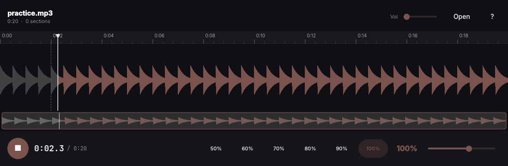

# riffer

A native Linux practice player for MP3 and WAV files, in the spirit of
[Transcribe!](https://www.seventhstring.com/xscribe/overview.html) but with
just what you need to learn a piece: slow it down without changing the pitch,
see the whole track, and loop passages until they sit under your fingers.

## What it does

- Opens MP3 and WAV (and anything else ffmpeg reads); can be the default
  application for both — run `bin/associate` once after installing.
- Changes playback speed from 20% to 150% with the pitch untouched:
  quick keys (`[` `]` for ±5%, `{` `}` for ±1%), presets (65/75/85/95/100)
  and a fine slider.
- Shows the whole track as a waveform; zoom with `Ctrl+wheel`, `+`/`-`, `F`
  (fit selection) and `0` (fit track). Click sets the play position; drag
  selects a passage; drag either edge to fine-tune it.
- Loops by default: the whole track, from the start cursor, or the
  selection — whichever is furthest along. Clicking the wave places the
  start cursor. `Space` plays from it; `Space` again stops and leaves the
  playhead standing there as a bookmark, so you can place the start
  cursor at (or near) where you stopped and pick up from there.
- Marks named sections (`M` at the start, `M` again at the end, `Shift+M`
  for the selection) with a panel (`Tab`) to jump, rename, play or delete.
  Sections, speed, volume and selection are saved to a
  `<file>.riffer.json` sidecar beside the audio, atomically. The cursor
  is not persisted: a track always opens at its start.
- A strip under the waveform shows the whole track with a viewport
  rectangle — click or drag it to move the zoomed view.

## Shortcuts

| Key | Action |
| --- | --- |
| `Space` | Play from the start cursor; stop keeps the playhead where it stopped |
| `[` `]` | Slower / faster by 5% |
| `{` `}` | Slower / faster by 1% |
| `1` `2` `3` `4` | Speed presets 100%, 95%, 85%, 75% |
| `←` `→` | Nudge the start cursor 0.5 s (`Shift`: 5 s) |
| `↑` `↓` | Volume ±5% |
| `I` / `O` | Selection start / end at the playhead |
| `M` | Mark a section (press twice), `Shift+M` from selection |
| `Tab` | Sections panel |
| `F` / `0` | Zoom to selection / whole track |
| `+` / `-`, `Ctrl+wheel` | Zoom |
| `Home` / `End` | Jump to start / end |
| `Ctrl+Z` / `Ctrl+Shift+Z` | Undo / redo a section edit |
| `Ctrl+O` | Open a file |
| `Esc` | Clear selection, close panels and dialogs |
| `?` | All shortcuts |
| `Q` | Quit |

## How it is built

C++ and Qt Quick, following the Omarchy app conventions (theme accent and
rounding live, xdg-desktop-portal file dialogs, keyboard-first). Decoding
goes through the `ffmpeg` command line; playback is an in-memory buffer
pumped through SoundTouch into `QAudioSink`, which makes the loops seamless
and the speed changes instant.

    ./bin/build     # qmake6 + make into build/riffer
    ./bin/test      # offscreen Qt Test run
    ./bin/install   # makepkg + pacman -U
    ./bin/associate # make riffer the default for MP3/WAV

There is a small headless interface for agents and scripts:

    riffer sections <file>            # table of saved sections
    riffer sections <file> --json

## License

MIT. The theme watcher, translator and portal file picker are adapted from
Omacut and Monologue (MIT, David Heinemeier Hansson).
